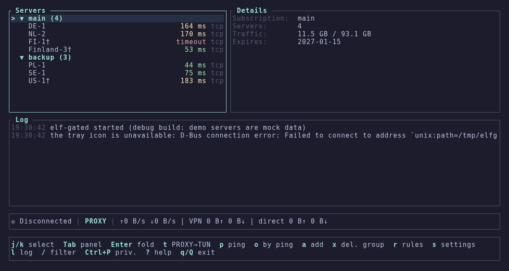

<p align="center">
  <b>elf-gate</b><br>
  <sub>a terminal client for xray-core · proxy or tun · rules per site, ip and process</sub>
</p>

<p align="center">
  <a href="https://github.com/z3nghoul/elf-gate/actions/workflows/ci.yml"></a>
  <a href="https://github.com/z3nghoul/elf-gate/releases/tag/v1.0.0"></a>
  
  <a href="LICENSE"></a>
</p>

<p align="center">
  
  
  
  
</p>

---

pick a server, press `Enter`, forget about it. servers and subscriptions, system proxy or a real tun device,
rules by site, ip and process (like "only discord through the vpn"), a primary and a backup server, live
traffic and latency. one keyboard-driven screen, no electron.

[SPEC.md](SPEC.md) · [decisions](docs/decisions.md)

<p align="center">
  
</p>

## ✦ quick start

grab the archive for your system from the [latest release](https://github.com/z3nghoul/elf-gate/releases/latest),
xray-core is already inside:

```sh
# linux
tar xzf elf-gate-linux-x86_64.tar.gz
cd elf-gate-linux-x86_64
./elf-gate
```

on windows unpack `elf-gate-windows-x86_64.zip` and run `elf-gate.exe`. then:

1. `a`, paste a server link or a subscription url, `Enter`
2. select a server, `Enter` to connect, `d` to disconnect
3. `t` switches proxy ↔ tun, `?` shows every key

<details>
<summary>What is in the archives</summary>

| File | What it is |
|---|---|
| `elf-gate` | the interface you run |
| `elf-gated` | the background part: holds the core, the system proxy, tun and the tray icon. `elf-gate` starts it by itself |
| `xray` / `xray.exe` | xray-core 26.11.9 |
| `geoip.dat`, `geosite.dat` | geodata for the routing rules |
| `wintun.dll` | the tun driver library (windows only) |
| `elf-gate-tun.sh` / `.bat` | start with tun support (see below) |
| `locales/` | the interface strings (en, ru, uk) |

</details>

## ✦ features

- **Proxy or tun.** system proxy (gnome, kde, windows) or a real tun interface. `t` switches.
- **Subscriptions.** plain links, base64, json configs with chains, hwid headers, auto update. hide a server from a subscription and it stays hidden after updates.
- **Rules.** by domain, ip, geosite, geoip and process, plus built-in presets: `discord-only`, `games-direct`, `torrents-direct`, `ru-direct`, `ua-direct` and more. exclude or include mode.
- **Primary and backup.** the backup takes over when the primary stops answering and gives the traffic back by itself.
- **Honest latency.** the connected server shows `31 tcp · 98 vpn` in one fixed format: tcp is the way to the server, vpn is a real request through the tunnel (median of a series, the cold first request thrown away).
- **tls fingerprint search.** when a provider breaks the handshake, elf-gate tries the fingerprints by itself. `f` picks one by hand, `z` turns fragmentation on.
- **Privacy mode.** `Ctrl+P` hides hosts, ips, keys and links on the screen and in the tray, for screenshots and streams.
- **Languages.** english, русский, українська. switch in settings, applied at once. hotkeys also work on the russian and ukrainian layouts.
- **Tray icon** with connect, disconnect, server list and mode.

## ✦ how it works

two programs in one folder. `elf-gate` is the terminal ui, `elf-gated` is a windowless background part. closing the ui
with `q` keeps the vpn up, `Q` stops everything.

```text
elf-gate (tui)  ──  unix socket / named pipe, owner only  ──  elf-gated ──► xray-core
                                                                  ├─ system proxy
                                                                  ├─ tun
                                                                  └─ tray icon
```

links and keys never travel through that channel. the log file is always english, secrets in it are hidden.

## ✦ keys

`?` in the program shows all of them, the help is built from the same table as the key handler.

| Key | Action |
|---|---|
| `j` `k` · `↑` `↓` | move |
| `Enter` | connect / disconnect |
| `t` | proxy ↔ tun |
| `a` | add a link or a subscription |
| `p` · `o` · `u` | ping · sort by ping · update subscriptions |
| `r` · `s` · `l` | rules · settings · log |
| `f` · `b` · `z` | tls fingerprint · role (primary / backup) · fragmentation |
| `Ctrl+P` · `Ctrl+L` | privacy mode · redraw the screen |
| `q` · `Q` | close the interface · stop everything |

## ✦ recipes

- **Only discord.** `t` for tun, `Enter`; on the first tun start answer `y` to the `discord-only` preset. discord (voice and streams over udp too) goes through the vpn, everything else goes direct.
- **Everything except games.** exclude mode, open rules (`r`) and turn on `games-direct` and `torrents-direct`.
- **Two servers.** select the main one, `b` → primary; the other one, `b` → backup. connect to the primary: if it dies, traffic moves to the backup in about 10 seconds and comes back by itself.

## ✦ tun

**Windows.** needs administrator rights: the background part restarts itself through uac, the interface stays normal.

**Linux, without running as root.** xray needs a root-owned copy with the right to create interfaces. `elf-gate-tun.sh` does it once (asks for sudo, installs the copy into `/usr/local/lib/elf-gate/`). by hand:

```sh
sudo install -o root -g root -m 755 xray /usr/local/lib/elf-gate/xray
sudo setcap cap_net_admin,cap_sys_ptrace,cap_dac_read_search+ep /usr/local/lib/elf-gate/xray
```

the last two capabilities let xray see which program owns a connection (chromium, electron, discord from flatpak), without them process rules do not work for those. `ELF_GATE_FULL_CAPS=0 ./elf-gate-tun.sh` keeps only `cap_net_admin`. details in [docs/linux-tun-setup.md](docs/linux-tun-setup.md).

## ✦ where things live

| What | Linux | Windows |
|---|---|---|
| config (servers, subscriptions, settings) | `~/.config/elf-gate/config.toml` | `%APPDATA%\elf-gate\` |
| logs and run state | `~/.local/state/elf-gate/` | next to the config |

your config is never part of the repository or the archives.

## ✦ language

english is the default and does not depend on the system language. settings (`s`), the first row, `Enter` cycles en → ru → uk
and applies at once, the tray included. stored as `ui.language` in `config.toml`. the strings live in `locales/*.toml`
(the same keys in every language, tests check that).

## ✦ build

```sh
git clone https://github.com/z3nghoul/elf-gate
cd elf-gate
cargo build --release
cargo test
cargo clippy --all-targets -- -D warnings
```

the tests that need a real xray look for `XRAY_PATH`, then `bin/xray`, and print `SKIPPED` if there is none.
put xray, `geoip.dat` and `geosite.dat` into `bin/` (it is in `.gitignore`, binaries never get committed).

a windows `.exe` is built by ci on `windows-latest`. locally `cargo check --target x86_64-pc-windows-gnu` is enough;
a full cross build needs `mingw-w64` and `rustup target add x86_64-pc-windows-gnu`.
open points of the windows build are in [docs/windows-checklist.md](docs/windows-checklist.md).

## ✦ license

elf-gate is licensed under the [GNU Affero General Public License v3.0](LICENSE). the archives also carry xray-core
(MPL-2.0) and wintun, each with its own license file next to the binary (`LICENSE-Xray`, `LICENSE-Wintun`).

---

<p align="center">
  <sub>made with 💜 and too many monsters · somewhere in ukraine</sub>
</p>
