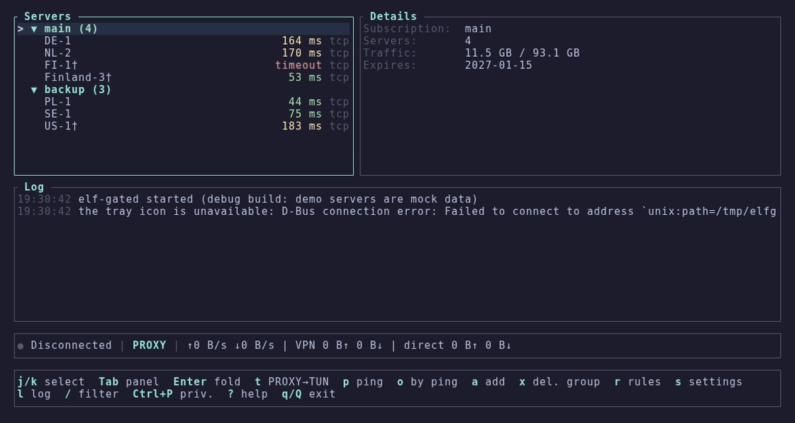

<p align="center">
  <b>elf-gate</b><br>
  <sub>терминальный клиент для xray-core · прокси или tun · правила по сайтам, ip и процессам</sub>
</p>

<p align="center">
  <a href="https://github.com/z3nghoul/elf-gate/actions/workflows/ci.yml"></a>
  <a href="https://github.com/z3nghoul/elf-gate/releases/tag/v1.0.0"></a>
  
  <a href="LICENSE"></a>
</p>

<p align="center">
  
  
  
  
</p>

---

выбираешь сервер, жмёшь `Enter`, забываешь. серверы и подписки, системный прокси или настоящий tun-интерфейс,
правила по сайтам, ip и процессам (например, «только discord через vpn»), основной и запасной сервер, живая
статистика трафика и задержек. один экран, всё с клавиатуры, никакого electron.

[English](README.md) · **Русский** · [Українська](README.uk.md) · [SPEC.md](SPEC.md) · [решения](docs/decisions.md)

<p align="center">
  
</p>

## ✦ быстрый старт

возьми архив для своей системы из [последнего релиза](https://github.com/z3nghoul/elf-gate/releases/latest),
xray-core уже внутри:

```sh
# linux
tar xzf elf-gate-linux-x86_64.tar.gz
cd elf-gate-linux-x86_64
./elf-gate
```

на windows распакуй `elf-gate-windows-x86_64.zip` и запусти `elf-gate.exe`. дальше:

1. `a`, вставь ссылку на сервер или адрес подписки, `Enter`
2. выбери сервер, `Enter` подключает, `d` отключает
3. `t` переключает прокси ↔ tun, `?` показывает все клавиши

<details>
<summary>Что лежит в архивах</summary>

| Файл | Что это |
|---|---|
| `elf-gate` | интерфейс, его ты и запускаешь |
| `elf-gated` | фоновая часть: держит ядро, системный прокси, tun и значок в трее. `elf-gate` запускает её сам |
| `xray` / `xray.exe` | xray-core 26.11.9 |
| `geoip.dat`, `geosite.dat` | геоданные для правил маршрутизации |
| `wintun.dll` | библиотека драйвера tun (только windows) |
| `elf-gate-tun.sh` / `.bat` | запуск с поддержкой tun (см. ниже) |
| `locales/` | копии строк интерфейса (en, ru, uk), в программе они уже вшиты (архив linux) |
| `ТЕСТ-README.txt`, `ЧЕК-ЛИСТ.txt` | заметки тестировщику и чек-лист, по-русски (архив windows) |

</details>

## ✦ возможности

- **Прокси или tun.** системный прокси (gnome, kde, windows) или настоящий tun-интерфейс. переключает `t`.
- **Подписки.** обычные ссылки, base64, json-конфиги с цепочками, hwid-заголовки, автообновление. скрытый из подписки сервер остаётся скрытым и после обновлений.
- **Правила.** по домену, ip, geosite, geoip и процессу, плюс встроенные пресеты: `discord-only`, `games-direct`, `torrents-direct`, `ru-direct`, `ua-direct` и другие. режим exclude или include.
- **Основной и запасной.** запасной подхватывает трафик, когда основной перестаёт отвечать, и сам возвращает его обратно.
- **Честная задержка.** у подключённого сервера всегда один формат `31 tcp · 98 vpn`: tcp это путь до сервера, vpn это настоящий запрос через туннель (медиана серии, первый «холодный» запрос отбрасывается).
- **Подбор tls fingerprint.** если провайдер ломает рукопожатие, elf-gate сам перебирает fingerprint. `f` выбирает вручную, `z` включает фрагментацию.
- **Режим приватности.** `Ctrl+P` скрывает хосты, ip, ключи и ссылки на экране и в трее, для скриншотов и стримов.
- **Языки.** english, русский, українська. переключается в настройках и применяется сразу. горячие клавиши работают и в русской, и в украинской раскладке.
- **Значок в трее** с подключением, отключением, списком серверов и режимом.

## ✦ как это устроено

две программы в одной папке. `elf-gate` это терминальный интерфейс, `elf-gated` это фоновая часть без окна. закрытие
интерфейса клавишей `q` оставляет vpn включённым, `Q` останавливает всё.

```text
elf-gate (tui)  ──  unix-сокет / именованный канал, только для владельца  ──  elf-gated ──► xray-core
                                                                                ├─ системный прокси
                                                                                ├─ tun
                                                                                └─ значок в трее
```

канал локальный и открыт только владельцу. введённая тобой ссылка уходит в фоновую часть и обратно не возвращается: интерфейс получает состояние без ссылок на серверы, адресов подписок и ключей. файл лога всегда на английском, секреты в нём скрыты.

## ✦ клавиши

`?` в программе показывает все, справка строится из той же таблицы, что и обработчик клавиш.

| Клавиша | Действие |
|---|---|
| `j` `k` · `↑` `↓` | перемещение |
| `Enter` | подключить / отключить |
| `t` | прокси ↔ tun |
| `a` | добавить ссылку или подписку |
| `p` · `o` · `u` | пинг · сортировка по пингу · обновить подписки |
| `r` · `s` · `l` | правила · настройки · журнал |
| `f` · `b` · `z` | tls fingerprint · роль (основной / запасной) · фрагментация |
| `Ctrl+P` · `Ctrl+L` | режим приватности · перерисовать экран |
| `q` · `Q` | закрыть интерфейс · остановить всё |

## ✦ сценарии

- **Только discord.** `t` для tun, `Enter`; при первом запуске tun ответь `y` на вопрос про пресет `discord-only`. discord (голос и стримы по udp тоже) идёт через vpn, всё остальное напрямую.
- **Всё, кроме игр.** режим exclude, открой правила (`r`) и включи `games-direct` и `torrents-direct`.
- **Два сервера.** выбери основной, `b` → основной; другой, `b` → запасной. подключайся к основному: если он откажет, трафик уйдёт на запасной примерно за 10 секунд и сам вернётся.

## ✦ tun

**Windows.** нужны права администратора: фоновая часть сама перезапустится через uac, интерфейс останется обычным.

**Linux, без запуска от root.** xray нужна копия, принадлежащая root, с правом создавать интерфейсы. `elf-gate-tun.sh` делает это один раз (спросит sudo, поставит копию в `/usr/local/lib/elf-gate/`). вручную:

```sh
sudo install -o root -g root -m 755 xray /usr/local/lib/elf-gate/xray
sudo setcap cap_net_admin,cap_sys_ptrace,cap_dac_read_search+ep /usr/local/lib/elf-gate/xray
```

последние два права позволяют xray видеть, какой программе принадлежит соединение (chromium, electron, discord из flatpak), без них правила по процессам для таких программ не работают. `ELF_GATE_FULL_CAPS=0 ./elf-gate-tun.sh` оставляет только `cap_net_admin`. подробности в [docs/linux-tun-setup.md](docs/linux-tun-setup.md).

## ✦ где что лежит

| Что | Linux | Windows |
|---|---|---|
| конфиг (серверы, подписки, настройки) | `~/.config/elf-gate/config.toml` | `%APPDATA%\elf-gate\` |
| логи и состояние запуска | `~/.local/state/elf-gate/` | рядом с конфигом |

твой конфиг никогда не попадает ни в репозиторий, ни в архивы.

## ✦ язык

английский по умолчанию и не зависит от языка системы. настройки (`s`), первая строка, `Enter` переключает en → ru → uk
и применяет сразу, включая трей. хранится как `ui.language` в `config.toml`. строки лежат в `locales/*.toml`
(одинаковые ключи во всех языках, это проверяют тесты).

## ✦ сборка

```sh
git clone https://github.com/z3nghoul/elf-gate
cd elf-gate
cargo build --release
cargo test
cargo clippy --all-targets -- -D warnings
```

тесты, которым нужен настоящий xray, ищут `XRAY_PATH`, потом `bin/xray`, а если его нет, печатают `SKIPPED`.
положи xray, `geoip.dat` и `geosite.dat` в `bin/` (он в `.gitignore`, бинарники никогда не коммитятся).

windows-`.exe` собирает ci на `windows-latest`. локально достаточно `cargo check --target x86_64-pc-windows-gnu`;
для полной кросс-сборки нужны `mingw-w64` и `rustup target add x86_64-pc-windows-gnu`.
открытые вопросы windows-сборки в [docs/windows-checklist.md](docs/windows-checklist.md).

## ✦ лицензия

elf-gate распространяется под [GNU Affero General Public License v3.0](LICENSE). в архивах также лежат xray-core
(MPL-2.0) и wintun, у каждого рядом с бинарником свой файл лицензии (`LICENSE-Xray`, `LICENSE-Wintun`).

---

<p align="center">
  <sub>сделано с 💜 и слишком большим количеством monster · где-то в украине</sub>
</p>
