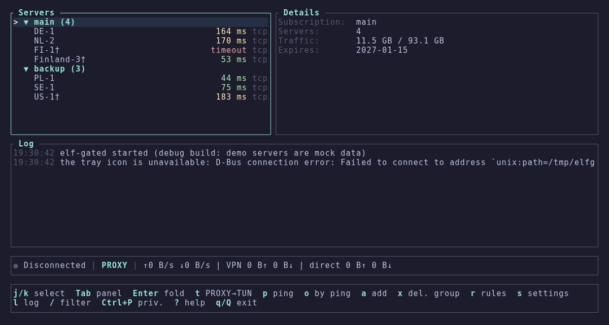

<p align="center">
  <b>elf-gate</b><br>
  <sub>термінальний клієнт для xray-core · проксі або tun · правила за сайтами, ip та процесами</sub>
</p>

<p align="center">
  <a href="https://github.com/z3nghoul/elf-gate/actions/workflows/ci.yml"></a>
  <a href="https://github.com/z3nghoul/elf-gate/releases/tag/v1.0.0"></a>
  
  <a href="LICENSE"></a>
</p>

<p align="center">
  
  
  
  
</p>

---

обираєш сервер, тиснеш `Enter`, забуваєш. сервери й підписки, системний проксі або справжній tun-інтерфейс,
правила за сайтами, ip та процесами (наприклад, «лише discord через vpn»), основний і запасний сервер, жива
статистика трафіку та затримок. один екран, усе з клавіатури, жодного electron.

[English](README.md) · [Русский](README.ru.md) · **Українська** · [SPEC.md](SPEC.md) · [рішення](docs/decisions.md)

<p align="center">
  
</p>

## ✦ швидкий старт

візьми архів для своєї системи з [останнього релізу](https://github.com/z3nghoul/elf-gate/releases/latest),
xray-core уже всередині:

```sh
# linux
tar xzf elf-gate-linux-x86_64.tar.gz
cd elf-gate-linux-x86_64
./elf-gate
```

на windows розпакуй `elf-gate-windows-x86_64.zip` і запусти `elf-gate.exe`. далі:

1. `a`, встав посилання на сервер або адресу підписки, `Enter`
2. обери сервер, `Enter` підключає, `d` відключає
3. `t` перемикає проксі ↔ tun, `?` показує всі клавіші

<details>
<summary>Що лежить в архівах</summary>

| Файл | Що це |
|---|---|
| `elf-gate` | інтерфейс, його ти й запускаєш |
| `elf-gated` | фонова частина: тримає ядро, системний проксі, tun і значок у треї. `elf-gate` запускає її сам |
| `xray` / `xray.exe` | xray-core 26.11.9 |
| `geoip.dat`, `geosite.dat` | геодані для правил маршрутизації |
| `wintun.dll` | бібліотека драйвера tun (лише windows) |
| `elf-gate-tun.sh` / `.bat` | запуск із підтримкою tun (див. нижче) |
| `locales/` | копії рядків інтерфейсу (en, ru, uk), у програмі вони вже вбудовані (архів linux) |
| `ТЕСТ-README.txt`, `ЧЕК-ЛИСТ.txt` | нотатки для тестувальника та чек-лист, російською (архів windows) |

</details>

## ✦ можливості

- **Проксі або tun.** системний проксі (gnome, kde, windows) або справжній tun-інтерфейс. перемикає `t`.
- **Підписки.** звичайні посилання, base64, json-конфіги з ланцюжками, hwid-заголовки, автооновлення. прихований з підписки сервер лишається прихованим і після оновлень.
- **Правила.** за доменом, ip, geosite, geoip та процесом, а також вбудовані пресети: `discord-only`, `games-direct`, `torrents-direct`, `ru-direct`, `ua-direct` та інші. режим exclude або include.
- **Основний і запасний.** запасний підхоплює трафік, коли основний перестає відповідати, і сам повертає його назад.
- **Чесна затримка.** у підключеного сервера завжди один формат `31 tcp · 98 vpn`: tcp це шлях до сервера, vpn це справжній запит крізь тунель (медіана серії, перший «холодний» запит відкидається).
- **Підбір tls fingerprint.** якщо провайдер ламає рукостискання, elf-gate сам перебирає fingerprint. `f` обирає вручну, `z` вмикає фрагментацію.
- **Режим приватності.** `Ctrl+P` приховує хости, ip, ключі та посилання на екрані й у треї, для скриншотів і стрімів.
- **Мови.** english, русский, українська. перемикається в налаштуваннях і застосовується одразу. гарячі клавіші працюють і в російській, і в українській розкладці.
- **Значок у треї** з підключенням, відключенням, списком серверів і режимом.

## ✦ як це влаштовано

дві програми в одній теці. `elf-gate` це термінальний інтерфейс, `elf-gated` це фонова частина без вікна. закриття
інтерфейсу клавішею `q` лишає vpn увімкненим, `Q` зупиняє все.

```text
elf-gate (tui)  ──  unix-сокет / іменований канал, лише для власника  ──  elf-gated ──► xray-core
                                                                           ├─ системний проксі
                                                                           ├─ tun
                                                                           └─ значок у треї
```

канал локальний і відкритий лише власнику. введене тобою посилання йде до фонової частини й назад не повертається: інтерфейс отримує стан без посилань на сервери, адрес підписок і ключів. файл логу завжди англійською, секрети в ньому приховано.

## ✦ клавіші

`?` у програмі показує всі, довідка будується з тієї самої таблиці, що й обробник клавіш.

| Клавіша | Дія |
|---|---|
| `j` `k` · `↑` `↓` | переміщення |
| `Enter` | підключити / відключити |
| `t` | проксі ↔ tun |
| `a` | додати посилання або підписку |
| `p` · `o` · `u` | пінг · сортування за пінгом · оновити підписки |
| `r` · `s` · `l` | правила · налаштування · журнал |
| `f` · `b` · `z` | tls fingerprint · роль (основний / запасний) · фрагментація |
| `Ctrl+P` · `Ctrl+L` | режим приватності · перемалювати екран |
| `q` · `Q` | закрити інтерфейс · зупинити все |

## ✦ сценарії

- **Лише discord.** `t` для tun, `Enter`; під час першого запуску tun відповідь `y` на питання про пресет `discord-only`. discord (голос і стріми по udp теж) іде через vpn, усе інше напряму.
- **Усе, крім ігор.** режим exclude, відкрий правила (`r`) і ввімкни `games-direct` та `torrents-direct`.
- **Два сервери.** обери основний, `b` → основний; інший, `b` → запасний. підключайся до основного: якщо він відмовить, трафік піде на запасний приблизно за 10 секунд і сам повернеться.

## ✦ tun

**Windows.** потрібні права адміністратора: фонова частина сама перезапуститься через uac, інтерфейс залишиться звичайним.

**Linux, без запуску від root.** xray потрібна копія, що належить root, з правом створювати інтерфейси. `elf-gate-tun.sh` робить це один раз (запитає sudo, поставить копію в `/usr/local/lib/elf-gate/`). вручну:

```sh
sudo install -o root -g root -m 755 xray /usr/local/lib/elf-gate/xray
sudo setcap cap_net_admin,cap_sys_ptrace,cap_dac_read_search+ep /usr/local/lib/elf-gate/xray
```

останні два права дають xray змогу бачити, якій програмі належить з'єднання (chromium, electron, discord із flatpak), без них правила за процесами для таких програм не працюють. `ELF_GATE_FULL_CAPS=0 ./elf-gate-tun.sh` лишає тільки `cap_net_admin`. подробиці в [docs/linux-tun-setup.md](docs/linux-tun-setup.md).

## ✦ де що лежить

| Що | Linux | Windows |
|---|---|---|
| конфіг (сервери, підписки, налаштування) | `~/.config/elf-gate/config.toml` | `%APPDATA%\elf-gate\` |
| логи й стан запуску | `~/.local/state/elf-gate/` | поруч із конфігом |

твій конфіг ніколи не потрапляє ні до репозиторію, ні до архівів.

## ✦ мова

англійська за замовчуванням і не залежить від мови системи. налаштування (`s`), перший рядок, `Enter` перемикає en → ru → uk
і застосовує одразу, разом із треєм. зберігається як `ui.language` у `config.toml`. рядки лежать у `locales/*.toml`
(однакові ключі в усіх мовах, це перевіряють тести).

## ✦ збирання

```sh
git clone https://github.com/z3nghoul/elf-gate
cd elf-gate
cargo build --release
cargo test
cargo clippy --all-targets -- -D warnings
```

тести, яким потрібен справжній xray, шукають `XRAY_PATH`, потім `bin/xray`, а якщо його немає, друкують `SKIPPED`.
поклади xray, `geoip.dat` і `geosite.dat` у `bin/` (він у `.gitignore`, бінарники ніколи не комітяться).

windows-`.exe` збирає ci на `windows-latest`. локально досить `cargo check --target x86_64-pc-windows-gnu`;
для повного крос-збирання потрібні `mingw-w64` і `rustup target add x86_64-pc-windows-gnu`.
відкриті питання windows-збірки в [docs/windows-checklist.md](docs/windows-checklist.md).

## ✦ ліцензія

elf-gate поширюється за [GNU Affero General Public License v3.0](LICENSE). в архівах також лежать xray-core
(MPL-2.0) і wintun, у кожного поруч із бінарником свій файл ліцензії (`LICENSE-Xray`, `LICENSE-Wintun`).

---

<p align="center">
  <sub>зроблено з 💜 і надто великою кількістю monster · десь в україні</sub>
</p>
